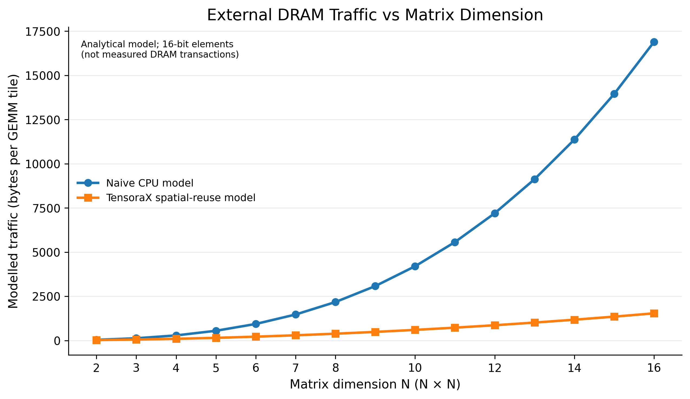
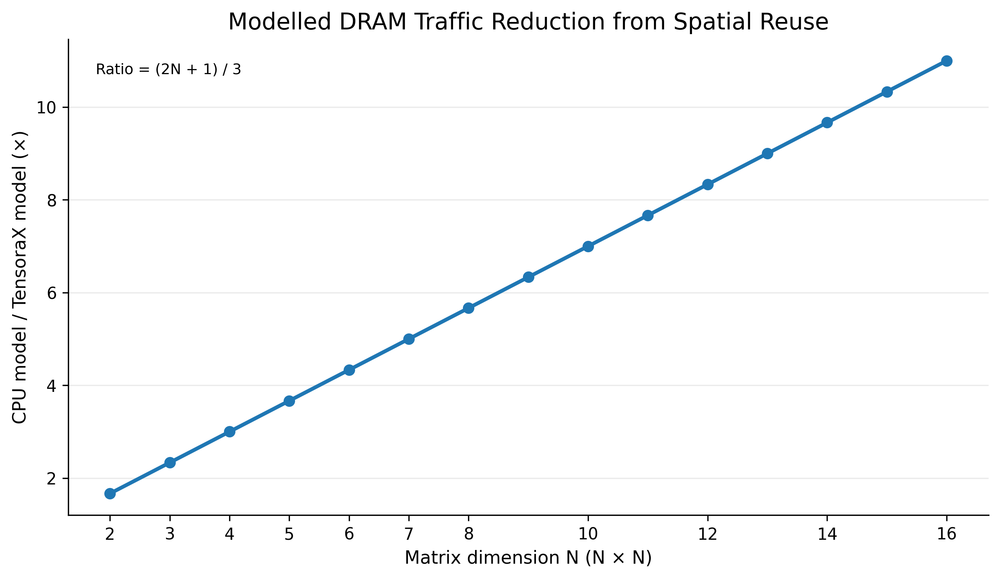
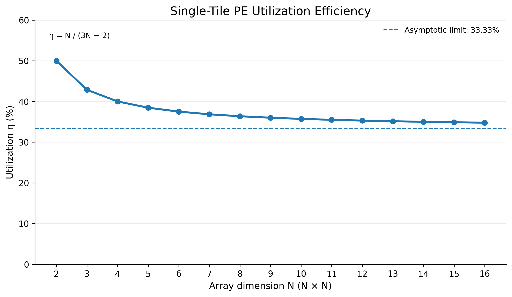
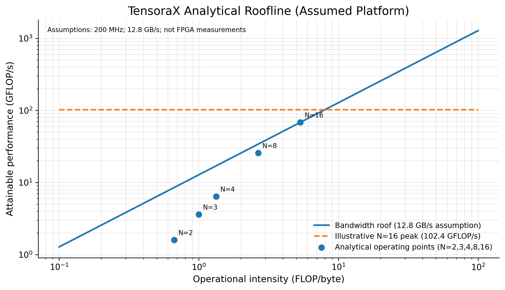

# TensoraX: 2D Systolic Array Matrix Multiplication Accelerator

[](rtl/)
[](tb/)
[](docs/synthesis/)
[]()

TensoraX is a cycle-accurate, synthesizable 2D mesh systolic array accelerator designed to accelerate General Matrix Multiply (GEMM) computations in Deep Learning and Edge AI workloads.

Inspired by AI acceleration hardware such as the Google TPU (Tensor Processing Unit) and NVIDIA Tensor Cores, TensoraX mitigates the Von-Neumann memory-wall bottleneck by rhythmically streaming matrix activations and weights spatially through an interconnected grid of dedicated Processing Elements (PEs).

---

## Engineering Team and Phase-wise Allocation

### Phase 2 Core Engineering Team (Active Execution)

| Member | Engineering Specialization | Phase 2 Core Technical Deliverables |
| :--- | :--- | :--- |
| **Adnan Rizvi** | **Lead Microarchitect & Architecture Specialist** | - Mathematical scaling derivation: $T(N) = 3N - 2$ cycle latency proof across $N=2..16$.<br>- Continuous batch streaming model ($\approx 98.7\%$ sustained PE utilization).<br>- External memory traffic model ($2.33\times$ to $11\times$ DRAM bandwidth reduction vs naive CPU).<br>- Analytical Roofline model ($N/3\text{ FLOP/B}$ operational intensity, memory vs compute crossovers).<br>- Microarchitecture defense: critical path breakdown ($F_{\max} \approx 263\text{ MHz}$ on Artix-7), DSP mapping, and accumulator bitwidth safety.<br>- Regression test suite orchestration (`scripts/run_all_tests.sh`). |
| **Aviral Mishra** | **FPGA Synthesis & Timing Closure Lead** | - Yosys synthesis flow for Xilinx Artix-7 (`synth_yosys.ys`) and Lattice ECP5 (`synth_ecp5.ys`).<br>- Multi-seed place-and-route timing closure via Nextpnr (`nextpnr-ecp5`, seeds 1-3, $F_{\max} \approx 93\text{ MHz}$).<br>- Gate-level resource mapping analysis (9 DSP48E1, 72 CARRY4, 576 LUTs, 482 FFs).<br>- Synthesis validation report (`docs/SYNTHESIS_REPORT.md`) and SHA-256 checksum manifest (`MANIFEST.txt`). |
| **Praanshu Ranjan** | **Benchmarking & IEEE Report Lead** | - Sequential C CPU baseline (`scripts/cpu_baseline.c`) verified bit-exact against 5,400 RTL test vectors.<br>- CPU vs FPGA speedup benchmark suite (`scripts/run_cpu_benchmark.py`) evaluating $S=7.3\times$ cycle speedup.<br>- Cycle-accurate RTL timing check testbench (`tb/tb_array_timing_check.v`, `scripts/run_timing_checks.sh`).<br>- IEEE two-column final paper source (`docs/report/TensoraX_Final_Report.tex`) and compiled document (`docs/TensoraX_Final_Report.pdf`). |
| **Aditya Pal** | **Hardware Visualization & Demonstration Lead** | - Analytical performance and scaling visualization plots (`docs/plots/`).<br>- DRAM bandwidth reduction and PE utilization curves across matrix dimension sweeps.<br>- Roofline operational intensity charts and platform comparison curves. |

### Phase 1 Engineering Team (Foundation & RTL Verification)

| Member | Phase 1 Role | Deliverables |
| :--- | :--- | :--- |
| **Adnan Rizvi** | Lead Datapath Architect | 16-bit MAC core (`mac_unit.v`), PE datapath (`pe.v`), Python golden reference model. |
| **Aviral Mishra** | 2D Grid Architect | 2D mesh routing (`systolic_array_3x3.v`), horizontal activation and vertical weight interconnects. |
| **Anurag Pandey** | Verification Engineer | Top-level self-checking testbenches, cycle assertions, corner cases, and bug injection tests. |
| **Praanshu Ranjan** | Documentation & Toolflow | Toolflow automation, initial benchmarking, and Phase 1 IEEE report draft. |
| **Aditya Pal** | Demonstration Lead | Architectural schematics, GTKWave markers, and hardware demo video. |

---

## System Architecture and Microarchitecture Diagrams

### 1. 2D Orthogonal Mesh Grid Topology ($3 \times 3$)

Matrix $A$ inputs stream horizontally from the West boundary, while Matrix $B$ inputs stream vertically from the North boundary. Both streams are skewed by 1 cycle per row/column to synchronize operand wavefronts at diagonal PEs.

```
                           B_col0           B_col1           B_col2
                             |                |                |
                             v                v                v
         +-------+     +-----------+    +-----------+    +-----------+
A_row0 ->| Skew0 |---->|  PE(0,0)  |--->|  PE(0,1)  |--->|  PE(0,2)  |
         +-------+     +-----------+    +-----------+    +-----------+
                             |                |                |
                             v                v                v
         +-------+     +-----------+    +-----------+    +-----------+
A_row1 ->| Skew1 |---->|  PE(1,0)  |--->|  PE(1,1)  |--->|  PE(1,2)  |
         +-------+     +-----------+    +-----------+    +-----------+
                             |                |                |
                             v                v                v
         +-------+     +-----------+    +-----------+    +-----------+
A_row2 ->| Skew2 |---->|  PE(2,0)  |--->|  PE(2,1)  |--->|  PE(2,2)  |
         +-------+     +-----------+    +-----------+    +-----------+
                             |                |                |
                             v                v                v
```

### 2. Processing Element (PE) Internal Datapath

Each Processing Element operates on an **Output-Stationary (OS)** dataflow. Accumulators retain partial sums locally, while activations and weights travel east and south through pipeline registers every cycle.

```
                                  B_in [15:0] (From North)
                                             |
                                             v
                                  +---------------------+
                                  |  B_reg [15:0] (FF)  |
                                  +----------+----------+
                                             |
                   +-------------------------+-------------------------+
                   |                                                   |
                   v                                                   v
A_in [15:0] -> [ A_reg [15:0] ]                                [ 16x16 Signed Multiplier ]
(From West)        |                                                   |
                   v                                                   v
              A_out [15:0]                                      Product [31:0]
               (To East)                                               |
                                                                       v
                                                               [ 32-bit Adder ] <----+
                                                                       |             |
                                                                       v             |
                                                               [ Acc Register ] -----+
                                                                       |
                                                                       v
                                                                  C_out [31:0]
                                                                       |
                                                                       v
                                                                  B_out [15:0]
                                                                   (To South)
```

Mathematical operations evaluated every clock edge:

$$\text{Acc}_{i,j}[t] = \text{Acc}_{i,j}[t-1] + (A_{\text{in}}[t] \times B_{\text{in}}[t])$$

$$A_{\text{out}}[t+1] = A_{\text{in}}[t], \quad B_{\text{out}}[t+1] = B_{\text{in}}[t]$$

---

### 3. Wavefront Skew and Execution Timeline ($3 \times 3$)

Input data must be staggered so that operand pairs $A_{i,k}$ and $B_{k,j}$ arrive at $\text{PE}_{i,j}$ concurrently at cycle $t = i + j + k$:

```
Cycle:      T0          T1          T2          T3          T4          T5          T6
-----------------------------------------------------------------------------------------
A_row 0:  [ A00 ]     [ A01 ]     [ A02 ]        -           -           -           -
A_row 1:     -        [ A10 ]     [ A11 ]     [ A12 ]        -           -           -
A_row 2:     -           -        [ A20 ]     [ A21 ]     [ A22 ]        -           -

B_col 0:  [ B00 ]     [ B10 ]     [ B20 ]        -           -           -           -
B_col 1:     -        [ B01 ]     [ B11 ]     [ B21 ]        -           -           -
B_col 2:     -           -        [ B02 ]     [ B12 ]     [ B22 ]        -           -
-----------------------------------------------------------------------------------------
Active:   PE(0,0)     Diagonal    Diagonal     Center     Diagonal    Diagonal    PE(2,2)
          starts      PE(0,1),    PE(0,2),     active     PE(1,2),    settles     settles
                      PE(1,0)     PE(1,1),                PE(2,1)
                                  PE(2,0)
```

At **Cycle 6 (7th cycle)**, the corner element $\text{PE}_{2,2}$ finishes its third accumulation, and all nine matrix entries $C_{0,0} \dots C_{2,2}$ become valid concurrently ($T = 3N - 2$).

---

## Architectural Scaling and Roofline Visualizations

TensoraX includes an analytical framework and Roofline model that characterize performance scaling, memory traffic reduction, and compute intensity.

### 1. External Memory DRAM Traffic Reduction
Because operands are forwarded horizontally and vertically across PEs rather than refetched from memory, external bus reads are reduced by a factor of $\frac{2N + 1}{3}\times$ over cache-less processors:





### 2. Processing Element Utilization Across Dimensions
Single-tile execution efficiency scales as $\eta = \frac{N}{3N - 2}$, approaching $33.3\%$ asymptotically due to edge fill/drain latency. In continuous batch streaming mode, utilization reaches **$98.7\%$** across 100 pipelined matrix tiles:



### 3. Roofline Model and Operational Intensity
With operational intensity $I = \frac{N}{3}\text{ FLOP/B}$, TensoraX transitions from memory-bandwidth-bound to compute-bound as matrix dimensions scale:



---

## Hardware Specifications and Synthesis Results

| Parameter | Specification | Architectural Details |
| :--- | :--- | :--- |
| **Array Geometry** | $3 \times 3$ Orthogonal Mesh | 9 PEs, parameterizable to $N \times N$ |
| **Input Precision** | Signed 16-bit Integer (`INT16`) | Two's complement (`signed [15:0]`) |
| **Accumulator Bitwidth** | Signed 32-bit Integer (`INT32`) | Overflow guard dynamic range $[-2^{31}, +2^{31}-1]$ |
| **Compute Latency** | $3N - 2 = 7$ Clock Cycles | Matrix multiplication completed in 7 clock edges |
| **Throughput** | 9 MACs / clock cycle | 18 FLOPs/cycle peak theoretical |
| **Artix-7 Synthesis (Yosys)** | 9 DSP48E1, 576 LUTs, 482 FFs | 1:1 hardware multiplier to DSP slice inference |
| **ECP5 Place & Route (Nextpnr)** | $F_{\max} = 92.97 - 93.68\text{ MHz}$ | Measured across 3 random placement seeds |
| **CPU Speedup Advantage** | $S = 7.3\times$ Cycle Speedup | 7 hardware cycles vs 51 cycles on sequential C |

---

## Verification and Test Suite

All 7 test suites are executed via an automated regression script with automated pass/fail verification:

```bash
./scripts/run_all_tests.sh
```

| Verification Target | Test Scope | Result |
| :--- | :--- | :--- |
| `tb_pe.v` | Processing Element arithmetic & pipeline registers | PASS (0 errors) |
| `tb_systolic_array_3x3.v` | Directed matrix testbench (4 workloads, 7-cycle check) | PASS (0 errors) |
| `tb_systolic_array_random.v` | 600 randomized operations, 5,400 output checks | PASS (390,357 assertions, 0 errors) |
| `tb_array_corner_cases.v` | 13 corner cases: extremes, hold, mid-operation reset | PASS (29,826 assertions, 0 errors) |
| `tb_array_overflow_check.v` | Boundary wrap behavior at extreme rail inputs | PASS (Deterministic wrap confirmed) |
| `pe_golden_model.py` | Bit-exact verification against NumPy reference | PASS (Bit-identical) |
| `run_scaling_suite.sh` | Analytical scaling and Roofline model equations | PASS (Model convergence verified) |
| `run_timing_checks.sh` | Latency and tile spacing checks for $N = 2 \dots 8$ | PASS (Conforms to $3N-2$ bound) |

---

## Reproduction and Quickstart

### 1. Run Complete RTL Regression Suite
```bash
./scripts/run_all_tests.sh
```

### 2. Run Latency and Tile Spacing Checks
```bash
./scripts/run_timing_checks.sh
```

### 3. Run CPU Baseline and Speedup Benchmark
```bash
python3 scripts/run_cpu_benchmark.py --quick
```

### 4. Run Analytical Scaling & Roofline Models
```bash
./scripts/run_scaling_suite.sh
```

### 5. Inspect Waveforms in GTKWave
```bash
gtkwave sim/tb_systolic_array_3x3.vcd docs/waveforms/tensorax_array.gtkw
```

---

## Directory Organization

```
TensoraX/
├── README.md                      # Comprehensive architecture, team, and verification documentation
├── rtl/                           # Synthesizable Verilog HDL source files
│   ├── tensora_pkg.vh             # Global macro definitions, data widths, target frequencies
│   ├── mac_unit.v                 # Signed 16-bit MAC compute unit
│   ├── pe.v                       # Spatial Processing Element with accumulator
│   └── systolic_array_3x3.v       # 2D 3x3 systolic mesh top module
├── tb/                            # Verification testbenches and assertions
│   ├── tb_pe.v                    # PE unit testbench
│   ├── tb_systolic_array_3x3.v    # Directed 3x3 array testbench
│   ├── tb_systolic_array_random.v # Randomized testbench (600 operations)
│   ├── tb_array_corner_cases.v    # 13 corner cases & mid-operation reset checks
│   ├── tb_array_overflow_check.v  # Dynamic range wrap verification
│   ├── tb_array_timing_check.v    # Cycle-level timing and tile spacing checks
│   ├── array_assertions.v         # Concurrent assertions monitor
│   └── vectors/                   # Randomized input test vectors
├── scripts/                       # Verification, scaling, and benchmarking tools
│   ├── run_all_tests.sh           # Master regression script
│   ├── run_timing_checks.sh       # Hardware timing check runner
│   ├── run_scaling_suite.sh       # Scaling and Roofline model execution runner
│   ├── run_cpu_benchmark.py       # CPU baseline speedup evaluation
│   ├── cpu_baseline.c             # Bit-accurate sequential C matrix multiplication kernel
│   ├── scaling_analysis.py        # Analytical scaling equations and DRAM traffic models
│   ├── roofline_model.py          # Operational intensity and Roofline derivation
│   ├── make_report_numbers.py     # LaTeX macro generator from hardware logs
│   └── make_report_figures.py     # Publication figure generator
└── docs/                          # Engineering reports and documentation
    ├── TensoraX_Final_Report.pdf  # Compiled IEEE two-column conference paper
    ├── SYNTHESIS_REPORT.md        # Yosys synthesis and Nextpnr timing report
    ├── SCALING_ANALYSIS.md        # Latency derivations and memory traffic savings
    ├── MICROARCHITECTURE_DEFENSE.md # Microarchitectural design rationale and DSP analysis
    ├── plots/                     # High-resolution scaling, traffic, and roofline plots
    ├── report/                    # Final report LaTeX sources, figures, and build scripts
    ├── synthesis/                 # Synthesis scripts, raw logs, Nextpnr outputs, and manifest
    └── waveforms/                 # GTKWave configurations and signal markers
```

---

## Academic Citation

Modern Computer Architecture (MCA), B.Tech in Computer Science & Artificial Intelligence.

```bibtex
@inproceedings{tensorax2026,
  title     = {TensoraX: A 3x3 Output-Stationary Systolic Array for Matrix Multiplication: RTL Design, FPGA Synthesis and CPU Benchmarking},
  author    = {Adnan Rizvi and Aviral Mishra and Praanshu Ranjan and Aditya Pal},
  booktitle = {Modern Computer Architecture Project Reports},
  year      = {2026}
}
```
