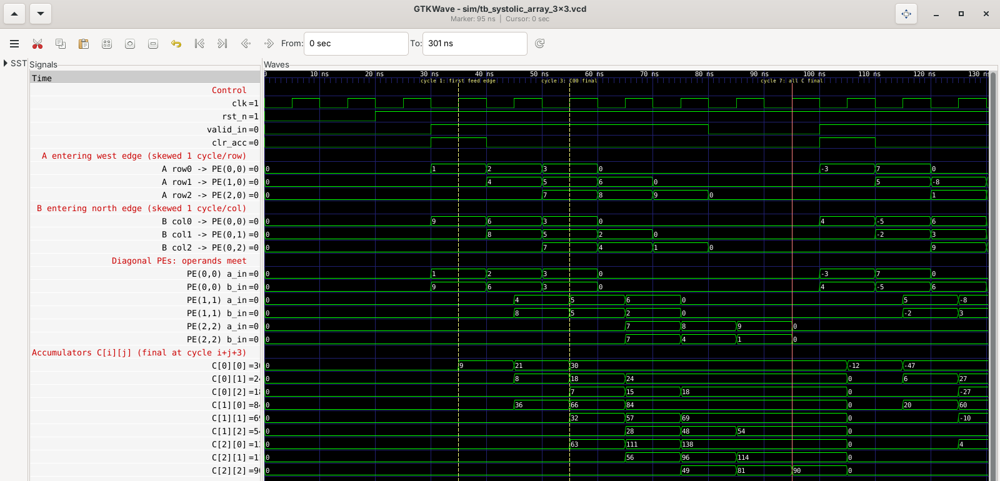
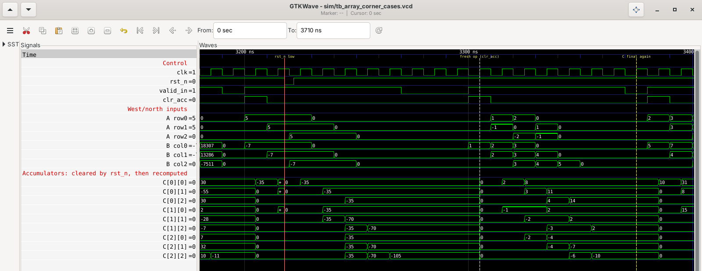

# TensoraX: Verification Report

**Role:** System Verification & Testbench Lead
**Design under test:** `rtl/systolic_array_3x3.v` (3x3 output-stationary systolic array built from `pe.v` and `mac_unit.v`)
**Tools:** Icarus Verilog 12 (RTL simulation), GTKWave 3.3 (waveforms), Python 3 (reference models)

All results below come from RTL simulation. There are no synthesis, area, timing-closure or formal-verification results.

---

## 1. Summary

| Item | Result |
| :--- | :--- |
| Regression (`./scripts/run_all_tests.sh`) | 6 / 6 items pass |
| Corner-case suite (`tb_array_corner_cases.v`) | 13 / 13 tests pass |
| Randomized suite (`tb_systolic_array_random.v`) | 600 operations, 5,400 outputs, 0 errors |
| Assertion checker (`array_assertions.v`) | 422,316 checks across 3 array testbenches, 0 failures |
| Bug injection (`./scripts/mutation_check.sh`) | 7 / 7 injected bugs caught |
| Waveform validation (GTKWave) | Skew, wavefront and 7-cycle latency confirmed, see Section 5 |

---

## 2. Verification strategy

The array is checked at three levels, each one independent of the others:

1. **End-to-end result checks.** Testbenches feed skewed A and B streams and compare all nine outputs with a golden model: inside the testbench for the directed and corner suites, and a separate Python model (`scripts/gen_array_vectors.py`) for the random suite.
2. **Cycle-level assertions.** `tb/array_assertions.v` watches every PE on every clock edge and checks the micro-architectural rules (forwarding, MAC update, reset, wiring). A bug that happens to leave the final matrix correct still trips an assertion.
3. **Waveform inspection.** GTKWave views of the reference case show the operand skew, the diagonal wavefront and the per-PE completion time.

The test suite itself is then checked by injecting known bugs into a copy of the RTL and confirming that each one is detected (Section 6).

---

## 3. Testbench inventory

| File | Type | What it checks |
| :--- | :--- | :--- |
| `tb/tb_pe.v` | Unit | PE forwarding and a 3-term dot product (44) |
| `tb/tb_systolic_array_3x3.v` | Directed | README ramp case, signed case, identity weights, 7-cycle latency, async reset |
| `tb/tb_systolic_array_random.v` | Randomized | 600 operations from a fixed seed, back-to-back and accumulate-without-clear operations |
| `tb/tb_array_overflow_check.v` | Demonstration | 32-bit wrap with all operands at -32768 |
| `tb/tb_array_corner_cases.v` | Corner cases + timing | 13 self-checking tests listed in Section 4.2 |
| `tb/array_assertions.v` | Checker module | Invariants A1 to A7, Section 4.1 |

The directed and random testbenches include the checker when compiled with `-DTENSORAX_ASSERT` (the regression script does this). Without the flag they compile exactly as before.

---

## 4. Assertions and corner cases

### 4.1 Assertion checker (`tb/array_assertions.v`)

Icarus Verilog does not support concurrent SystemVerilog assertions (SVA), so each property is written as an explicit clocked check that prints `[ASSERT-FAIL]` and is counted.

| ID | Property | Checked |
| :--- | :--- | :--- |
| A1 | `a_out`, `b_out`, `valid_out` equal the previous cycle's `a_in`, `b_in`, `valid_in` | every PE, every rising edge |
| A2 | Accumulator rule: `valid & !clr` adds `a*b`; `valid & clr` loads `a*b`; `!valid & clr` clears; otherwise holds. 32-bit two's-complement wrap | every PE, every rising edge |
| A3 | While `rst_n` is low, every PE register is zero | every PE, while reset is active |
| A4 | No X or Z on any PE output after reset | every PE, every cycle |
| A5 | Neighbour links: `PE(i,j+1).a_in == PE(i,j).a_out`, `PE(i+1,j).b_in == PE(i,j).b_out`, valid chain | every link, every cycle |
| A6 | West and north edge PEs see the `a_rows`, `b_cols`, `valid_in` ports | edge PEs, every cycle |
| A7 | `c_flat` slice `(i*N+j)` equals `PE(i,j).c_out` (row-major output map) | every PE, every cycle |

### 4.2 Corner-case suite (`tb/tb_array_corner_cases.v`)

| Test | Scenario | Why it matters |
| :--- | :--- | :--- |
| T01 | All-zero matrices | Baseline, no spurious accumulation |
| T02 | One-hot routing: all 27 `(i,k,j)` combinations | Any row/column mis-wiring shows up as a value in the wrong `C[i][j]` |
| T03 | Single extreme products (32767, -32768) | Signed multiply at the 16-bit limits |
| T04 | Largest sums that still fit: (-32768)² + 32767² = 2,147,418,113 | Accumulator correct right up to the 32-bit boundary |
| T05 | All -32768 and all 32767 (both overflow) | Wrap matches 32-bit two's complement exactly |
| T06 | Second operation without `clr_acc` | Accumulate-on-top mode |
| T07 | `clr_acc` after an accumulation | Old result is discarded |
| T08 | 12 idle cycles | Results hold when `valid_in` is low |
| T09 | Random garbage on inputs while `valid_in` is low | Inputs are ignored without valid |
| T10 | Random garbage in the B-side skew gaps | Gap values on one side never reach a MAC with real data |
| T11 | Reset in the middle of an operation, then a new operation | Async reset clears every PE and the array recovers |
| T12 | Per-PE timing | `PE(i,j)` is not final at cycle `i+j+2` and is final from cycle `i+j+3` |
| T13 | Two operations back to back | No idle cycle needed between operations |

---

## 5. GTKWave waveform validation

Open the saved views from the repo root:

```bash
./scripts/run_all_tests.sh        # generates the .vcd files in sim/
gtkwave sim/tb_systolic_array_3x3.vcd docs/waveforms/tensorax_array.gtkw --script=docs/waveforms/tensorax_markers.tcl
gtkwave sim/tb_array_corner_cases.vcd docs/waveforms/tensorax_reset.gtkw --script=docs/waveforms/tensorax_reset_markers.tcl
```

### 5.1 Wavefront and latency (README reference case)

A = [1 2 3; 4 5 6; 7 8 9], B = [9 8 7; 6 5 4; 3 2 1]



What the waveform shows:

- **Skew:** row 0 of A starts at 30 ns, row 1 at 40 ns, row 2 at 50 ns. Columns of B are skewed the same way.
- **Operands meet on the diagonal:** `PE(0,0)` multiplies (1,9), (2,6), (3,3) starting at 35 ns. `PE(1,1)` multiplies (4,8), (5,5), (6,2) starting two cycles later (55 ns), and `PE(2,2)` multiplies (7,7), (8,4), (9,1) starting four cycles later (75 ns). `PE(i,j)` starts `i+j` cycles after `PE(0,0)`.
- **Wavefront:** `C[0][0]` goes 9 → 21 → 30 and is final at 55 ns (cycle 3). `C[2][2]` goes 49 → 81 → 90 and is final at 95 ns (cycle 7). In general `C[i][j]` is final at cycle `i+j+3`.
- **Latency:** the full product is ready 7 cycles (3N-2) after the first feed edge. The final values match the golden result [30 24 18; 84 69 54; 138 114 90].

### 5.2 Reset in the middle of an operation (T11)



`rst_n` drops at 3218 ns while an operation is in flight and every accumulator goes to 0 immediately (asynchronous reset). The in-flight stream continues into the array after release, so the following values are partial. The next operation asserts `clr_acc` at 3305 ns, and by 3375 ns the outputs are exact again (for example `C[0][0] = 8`, `C[2][2] = -10`).

---

## 6. Bug injection (mutation) results

`./scripts/mutation_check.sh` copies the RTL to a temporary folder, inserts one bug at a time, and runs the corner and random suites with assertions. The real `rtl/` files are never changed.

| Injected bug | Old directed tb | Old random tb | New suite |
| :--- | :---: | :---: | :---: |
| A and B forwarding swapped in PE | caught | caught | caught |
| `clr_acc` drops the first product | caught | caught | caught |
| `mac_en` ignored (accumulator never holds) | **missed** | **missed** | caught (T09 + A2) |
| `valid_out` stuck high | **missed** | **missed** | caught (T09, T10 + A1) |
| B columns wired in reverse order | caught | caught | caught |
| Reset does not clear `a_out` | **missed** | **missed** | caught (A3/A4 only) |
| Accumulator loses its sign bit | caught | caught | caught |
| **Total** | **4 / 7** | **4 / 7** | **7 / 7** |

The original testbenches always drive zeros when idle, so bugs that only appear with non-zero idle inputs (or that leave the final matrix unchanged) passed unnoticed. The reset bug is caught only by the assertion checker, because the final results are still correct.

---

## 7. Findings and interface constraints

1. **Skew-gap values.** Inside the array, data from A always meets data from B, and gap cycles only meet other gap cycles. So gap values on one side are harmless (T10), but if both the A-side and B-side gaps carry non-zero values while `valid_in` is high, those values multiply and get accumulated. The corner suite demonstrates this (C01: 9 of 9 outputs corrupted). **Rule for users of the array: drive zeros in the skew gaps on at least one side.** The existing testbenches already do this.
2. **Overflow bound.** The 32-bit accumulator wraps once a dot product leaves the signed 32-bit range. Two products of extreme values fit (T04), but three products of ±32767 or -32768 do not (T05). With N = 3 the result is exact whenever every operand magnitude is at most 26,754 (3 × 26,754² < 2³¹).
3. **Reset during an operation.** Reset clears the accumulators but does not stop operands already queued at the inputs. Software or a controller should restart the operation with `clr_acc` after a reset (T11).

---

## 8. How to reproduce

```bash
./scripts/run_all_tests.sh      # full regression, exit code 0 on success
./scripts/mutation_check.sh     # bug-injection check, exit code 0 if all bugs are caught
```

Individual run of the corner suite:

```bash
mkdir -p sim
iverilog -g2012 -I rtl -o sim/corner.vvp rtl/mac_unit.v rtl/pe.v rtl/systolic_array_3x3.v \
    tb/array_assertions.v tb/tb_array_corner_cases.v && vvp sim/corner.vvp
```

## 9. Limitations

- Simulation only: no synthesis, area, power or timing-closure results.
- No formal verification; the assertions are simulation checks, not proofs.
- Only the 3x3 configuration (`N = 3`) is tested, although the RTL is parameterized.
