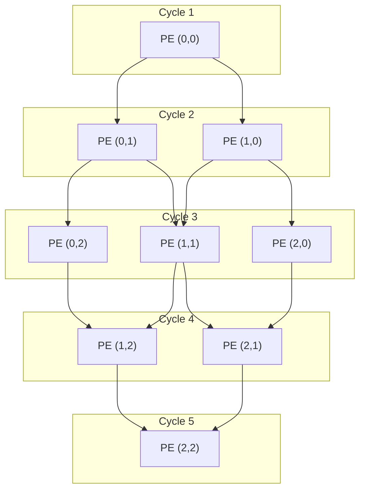

# TensoraX — 3×3 Systolic Wavefront Propagation

## 1. Introduction

TensoraX implements matrix multiplication using a 3×3 systolic array
consisting of nine Processing Elements (PEs).

The systolic architecture allows data to flow continuously through
neighbouring processing elements while performing parallel
Multiply-Accumulate (MAC) operations.

The wavefront represents the progressive movement of computation
across the array over successive clock cycles.

### Data Movement

- Activation values (A) enter from the West and propagate horizontally.
- Weight values (B) enter from the North and propagate vertically.
- Each PE receives an activation and a weight.
- Each PE performs multiplication and accumulates the result locally.
- Partial data is forwarded to neighbouring PEs.

---

## 2. Input Feed Schedule

The testbench uses a staggered input schedule to align activation
and weight operands at the appropriate processing elements.

### Test 1: Unsigned Ramp

| Feed Cycle | A Inputs (Rows) | B Inputs (Columns) |
|---:|---|---|
| 0 | [1, 0, 0] | [9, 0, 0] |
| 1 | [2, 4, 0] | [6, 8, 0] |
| 2 | [3, 5, 7] | [3, 5, 7] |
| 3 | [0, 6, 8] | [0, 2, 4] |
| 4 | [0, 0, 9] | [0, 0, 1] |

The zeros represent intentional gaps in the input streams.
They help synchronize the operands as they propagate through
the systolic array.

---

## 3. Systolic Array Structure

The 3×3 array contains nine processing elements.

```text
                 NORTH: Weight Inputs (B)
                       ↓       ↓       ↓

                  +--------+--------+--------+
                  | PE(0,0)| PE(0,1)| PE(0,2)|
                  +--------+--------+--------+
                      ↓        ↓        ↓

WEST: A  →       +--------+--------+--------+
                  | PE(1,0)| PE(1,1)| PE(1,2)|
                  +--------+--------+--------+
                      ↓        ↓        ↓

                 +--------+--------+--------+
                 | PE(2,0)| PE(2,1)| PE(2,2)|
                 +--------+--------+--------+

                 SOUTH: Weight Outputs
```

Activation values move from left to right, while weight values
move from top to bottom.

---

## 4. Wavefront Propagation Diagram

The following diagram groups the processing elements according
to the first cycle in which they perform a MAC operation.



Each processing element begins its MAC operations at a different
time depending on its position in the array.

The computation progresses diagonally from the top-left PE
towards the bottom-right PE.

**Note:** The arrows represent the conceptual progression of the
computation wavefront, not additional physical connections.
The actual data connections are shown in the architecture diagram.

---

## 5. MAC Accumulation Timing

Each processing element performs three multiplication and
accumulation operations.

The following table shows the cycles in which the three products
are accumulated at each PE.

| Processing Element | k = 0 | k = 1 | k = 2 |
|---|---:|---:|---:|
| PE(0,0) | 1 | 2 | 3 |
| PE(0,1) | 2 | 3 | 4 |
| PE(0,2) | 3 | 4 | 5 |
| PE(1,0) | 2 | 3 | 4 |
| PE(1,1) | 3 | 4 | 5 |
| PE(1,2) | 4 | 5 | 6 |
| PE(2,0) | 3 | 4 | 5 |
| PE(2,1) | 4 | 5 | 6 |
| PE(2,2) | 5 | 6 | 7 |

Cycle numbering begins at the first rising clock edge after the
initial input feed edge.

The first MAC operation occurs at PE(0,0), and the last
accumulation occurs at PE(2,2).

---

## 6. Multiply-Accumulate Operation

Every processing element performs the following operation:

C(i,j) = C(i,j) + A(i,k) × B(k,j)

Where:

- A(i,k) represents an activation input.
- B(k,j) represents a weight input.
- C(i,j) represents the local accumulated result.
- k represents the multiplication index.

For a 3×3 matrix multiplication, each PE performs three
multiply-accumulate operations.

The final result is:

C(i,j) = Σ A(i,k) × B(k,j), for k = 0 to 2

---

## 7. Simulation and Waveform Verification

The design was compiled and simulated using Icarus Verilog.

The generated Value Change Dump (VCD) file was inspected using
Surfer to observe internal signal transitions.

The following signals were inspected:

### Processing Element Signals

- a_in
- a_out
- b_in
- b_out
- c_out
- valid_in
- valid_out
- clk
- rst_n

### MAC Unit Signals

- a_val
- b_val
- product
- acc_out
- mac_en
- clr_acc

### Observed MAC Operation

One verified MAC operation showed:

| Signal | Value |
|---|---:|
| Operand A | 3 |
| Operand B | 3 |
| Product | 9 |
| Previous Accumulator | 21 |
| New Accumulator | 30 |

Therefore:

30 = 21 + (3 × 3)

This confirms the multiply-accumulate operation at the signal level.

---

## 8. Verified Matrix Output

The unsigned ramp test produced the following output matrix:

\[
C =
\begin{bmatrix}
30 & 24 & 18 \\
84 & 69 & 54 \\
138 & 114 & 90
\end{bmatrix}
\]

All nine processing element outputs matched the expected
software golden reference.

---

## 9. Verification Results

The testbench executed four verification scenarios.

| Test Case | Description | Result |
|---|---|---|
| Test 1 | Unsigned ramp inputs | PASS |
| Test 2 | Signed corner cases | PASS |
| Test 3 | Identity weights | PASS |
| Test 4 | Reset functionality | PASS |

**Final Simulation Result:**

- Total test cases: 4
- Passed test cases: 4
- Failed test cases: 0
- Verification errors: 0

---

## 10. Latency and Performance

For an N×N systolic array, the idealized computation latency
is commonly expressed as:

Latency = 3N - 2

For N = 3:

Latency = 3(3) - 2 = 7 cycles

The simulation testbench checks the final result at cycle 7.

This demonstrates the progressive computation and data
synchronization across the 3×3 systolic array.

---

## 11. Conclusion

The TensoraX systolic array demonstrates matrix multiplication
using parallel processing elements and local accumulation.

The wavefront visualisation explains how computation progresses
across the array, while waveform inspection provides evidence
of the internal multiply-accumulate operations.

The prototype successfully passed all four directed
verification tests with zero errors.

This validates the functional behaviour of the implemented
3×3 systolic array matrix multiplication accelerator.
