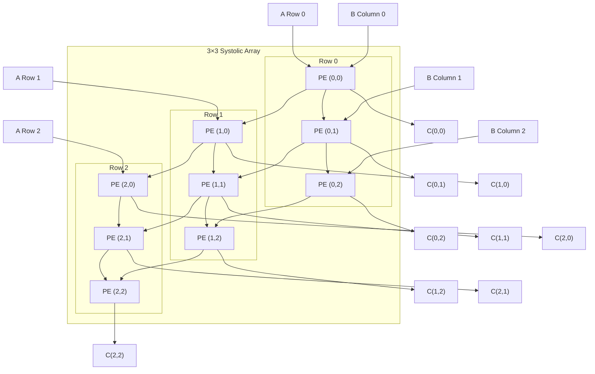

# TensoraX — 3×3 Systolic Array Architecture

## Overview

TensoraX uses a 3×3 systolic array consisting of nine Processing Elements (PEs).

- Activation values (A) enter from the West and move horizontally.
- Weight values (B) enter from the North and move vertically.
- Each PE contains a Multiply-Accumulate (MAC) unit.
- Each PE maintains its own local accumulator.
- The nine accumulated results form the output matrix C.

## Architecture Diagram

## Processing Element

Each PE performs the following operation:

C(i,j) = C(i,j) + A(i,k) × B(k,j)

The PE forwards activation data to its right neighbour and weight data to its bottom neighbour.

## Verified Test Result

The directed simulation produced:

C =

| 30 | 24 | 18 |
|---:|---:|---:|
| 84 | 69 | 54 |
| 138 | 114 | 90 |

All nine outputs matched the golden reference.

## Simulation Status

- Test 1: Unsigned ramp — PASS
- Test 2: Signed corner cases — PASS
- Test 3: Identity weights — PASS
- Test 4: Reset — PASS

Total verification errors: 0
